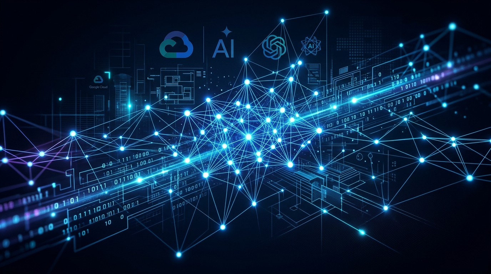
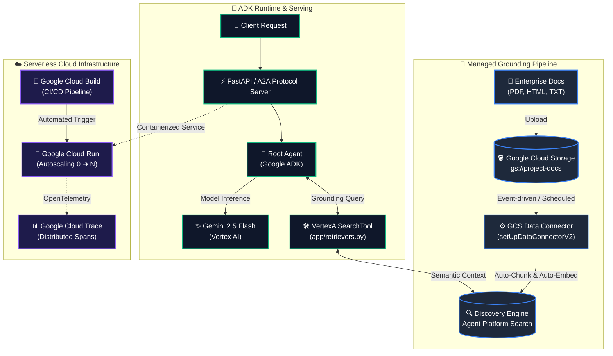

<div align="center">



# ⚡ AgentCLI RAG
### **Zero-Pipeline Enterprise RAG on Google Cloud**
*From local terminal idea to serverless production in minutes with Google Agents CLI & ADK*

[](https://cloud.google.com/vertex-ai)
[](https://deepmind.google/technologies/gemini/)
[](https://github.com/google/adk-recipes)
[](https://cloud.google.com/run)
[](https://www.python.org/)
[](LICENSE)

<br/>

[**Explore Architecture**](#-architecture) • [**Quickstart**](#-quickstart-in-60-seconds) • [**Scaffolding Flow**](#-the-interactive-scaffolding-journey) • [**Evaluation**](#-automated-quality-flywheel) • [**CI/CD & Deploy**](#-cloud-run--cicd-pipeline)

</div>

---

## 💡 Why This is a Game-Changer

> **80% of AI agent prototypes never reach production.** Developers get stuck writing fragile document chunking scripts, managing vector embedding drift, wrestling with session state, and hand-crafting Cloud Run YAML.

**AgentCLI RAG** flips this paradigm using Google's official **Agent Development Lifecycle (ADLC)** toolchain:

| Capability | ❌ Traditional DIY RAG | ⚡ AgentCLI + ADK Managed RAG |
| :--- | :--- | :--- |
| **Document Ingestion** | Custom chunking, embedding API loops, DB sync scripts | **Zero Ingestion Code:** Managed GCS Data Connector auto-indexes & syncs |
| **Vector Engine** | Complex vector DB maintenance, index tuning, OCR scripts | **Agent Platform Search (Discovery Engine):** Managed semantic search |
| **Local Prototyping** | Print statements, Jupyter notebooks, or crude terminal loops | **Interactive Web Playground:** Live hot-reload (`--reload_agents`) on port 8501 |
| **Quality & Hallucinations** | Manual spot-checks; zero regression safety | **Automated Eval Flywheel:** `agents-cli eval run` with Gemini LLM-as-judge |
| **CI/CD & Testing** | Mocked by hand; expensive live LLM calls on every PR | **Pre-wired Cloud Build:** Automated PR testing with zero-cost mocked retrievers |
| **Production Hosting** | Custom Dockerfiles, manual IAM, autoscaling scripts | **1-Command Deploy:** `agents-cli deploy` directly to Google Cloud Run |
| **Observability** | Custom logging; no distributed tracing | **Native OpenTelemetry:** Cloud Trace shows end-to-end latency breakdowns |

---

## 🏛️ Architecture



---

## 📸 The Interactive Scaffolding Journey

Here is the exact terminal flow used to scaffold this production-ready RAG agent in under 10 seconds:

<details open>
<summary><b>Step 0: Prerequisites & Skills Setup (<code>agents-cli setup</code>)</b></summary>
<br>

Verifies active Google Cloud credentials, installs CLI tooling via `uv`, and registers ADK lifecycle skills into your coding agent.


```bash
agents-cli setup
```
</details>

<details open>
<summary><b>Step 1 & 2: Interactive Wizard & Browsing ADK Recipes</b></summary>
<br>

Launches the interactive wizard. Select `3. Browse` $\rightarrow$ `2. google/adk-recipes` to access Google's curated catalog of production agent architectures.

<table>
<tr>
<td width="50%">
<p align="center"><b>Step 1: Main Menu</b></p>

</td>
<td width="50%">
<p align="center"><b>Step 2: Browse Recipes</b></p>

</td>
</tr>
</table>

```bash
agents-cli create my-agent -i
```
</details>

<details open>
<summary><b>Step 3 & 4: Selecting <code>rag-agent-search</code> & Cloud Run Target</b></summary>
<br>

Select option `17. rag-agent-search *` grounded on Discovery Engine, followed by serverless **Cloud Run**, in-memory sessions, and **Google Cloud Build** CI/CD.

<table>
<tr>
<td width="50%">
<p align="center"><b>Step 3: Select rag-agent-search</b></p>

</td>
<td width="50%">
<p align="center"><b>Step 4: Cloud Run & CI/CD</b></p>

</td>
</tr>
</table>
</details>

---

## ⚡ Quickstart in 60 Seconds

### Prerequisites
* Python 3.11+
* [`uv`](https://docs.astral.sh/uv/) package manager
* [Google Cloud SDK (`gcloud`)](https://cloud.google.com/sdk/docs/install)
* [Terraform](https://developer.hashicorp.com/terraform/install)
* Install Google Agents CLI:
  ```bash
  uv tool install google-agents-cli
  ```

### 1. Clone & Setup
```bash
git clone https://github.com/sanketbisne/agentcli-rag.git
cd agentcli-rag/my-agent

# Authenticate with Google Cloud
agents-cli login -i
# or: gcloud auth application-default login

# Setup environment configuration
cp .env.example .env
```

### 2. Run Local Tests (Instant Verification)
```bash
# Fast runnability test
uv run pytest tests/test_runnability.py

# Integration test with mocked retrievers (zero cloud cost)
make test
```

### 3. Launch Local Playground (Live Web UI)
```bash
agents-cli playground --reload_agents
```
👉 Open **`http://localhost:8501`** in your browser. Edit prompts in `app/agent.py` and watch changes hot-reload instantly!

---

## 🛠️ Grounding with Enterprise Data

No custom chunking scripts. No vector database maintenance. Just drop documents in Cloud Storage:

```bash
# 1. Provision GCS bucket & Discovery Engine Data Store
make setup-infra

# 2. Upload sample docs (or your own custom PDF / TXT / HTML files)
make upload-sample-data

# 3. Trigger immediate Discovery Engine ingestion
make ingest
```

---

## 🧪 Automated Quality Flywheel

Catch hallucinations and regressions before deploying code:

```bash
# Run automated inference over golden test cases & grade with Gemini LLM-as-judge
agents-cli eval run

# Compare two evaluation runs to prevent prompt regressions
agents-cli eval compare baseline_eval.json new_eval.json
```

```
================ EVALUATION SUMMARY ================
Total Cases:               15
Average Score:             4.92 / 5.0
Groundedness Pass Rate:    100%
Tool Call Precision:       100%
✓ QUALITY GATE PASSED: Ready for Production
```

---

## 🚀 Cloud Run & CI/CD Pipeline

Deploy to serverless production with a single command:

```bash
agents-cli deploy --deployment-target cloud_run
```

### Automated CI/CD with Google Cloud Build:
* **PR Verification (`.cloudbuild/pr_checks.yaml`)**: Automatically runs on every Pull Request. Restores dependencies via `uv`, runs linter checks, and verifies unit + integration tests with mocked retrievers.
* **Production Deployment (`.cloudbuild/deploy-to-prod.yaml`)**: Runs automatically upon merging to `main`. Builds the container, pushes to Google Artifact Registry, and deploys the new revision to Cloud Run.

---

## 📊 Full-Stack Observability

Every request emits distributed traces to **Google Cloud Trace**:

```text
Trace ID: 7f8a912b4e89 (Duration: 852ms)
├─ [POST /run_stream] (852ms)
│  ├─ [ADK Runner] Context & Session Resolution (12ms)
│  ├─ [Tool Call] VertexAiSearchTool: Discovery Engine Query (210ms)
│  │  └─ Retrieved 3 grounded snippets from GCS docs
│  └─ [Gemini 2.5 Flash] Stream Generation (615ms)
│     ├─ Input Tokens: 512 | Output Tokens: 184
│     └─ First Token Latency (TTFT): 140ms
└─ HTTP 200 OK (Emitted SSE Stream)
```

---

## 📁 Repository Structure

```
.
├── README.md                                  # You are here
├── screenshots/                               # Visual walkthrough & banner
│   ├── banner.png                             # Hero repository banner
│   ├── 01_agents_cli_setup.png
│   ├── 02_create_agent_menu.png
│   ├── 03_browse_adk_recipes.png
│   ├── 04_select_rag_agent_search.png
│   └── 05_select_deployment_target_cloud_run.png
└── my-agent/                                  # Scaffolded ADK RAG Project
    ├── app/
    │   ├── agent.py                           # Root Agent (Gemini 2.5 Flash + Search Tool)
    │   ├── retrievers.py                      # VertexAiSearchTool abstraction (with mock mode)
    │   └── fast_api_app.py                    # REST & SSE streaming server
    ├── infra/terraform/                       # GCS bucket, Data Connector & Search Engine HCL
    ├── .cloudbuild/
    │   ├── pr_checks.yaml                     # Automated PR test pipeline
    │   └── deploy-to-prod.yaml                # Production build & deploy pipeline
    ├── tests/
    │   ├── test_runnability.py                # Fast syntax & initialization assertion
    │   ├── unit/                              # Unit test suite
    │   ├── integration/                       # Integration tests (with mocked retrievers)
    │   └── eval/                              # Golden datasets for automated quality grading
    ├── agents-cli-manifest.yaml               # Single source of truth for the project
    └── pyproject.toml                         # Fast Python package management via uv
```

---

## ⭐ Star the Repo

If you find this project helpful or are building production AI agents on Google Cloud, please consider giving it a **Star** ⭐!

<div align="center">

Built with ❤️ using [**Google Agent Development Kit (ADK)**](https://github.com/google/adk-recipes) and [**Google Agents CLI**](https://cloud.google.com/).

</div>
