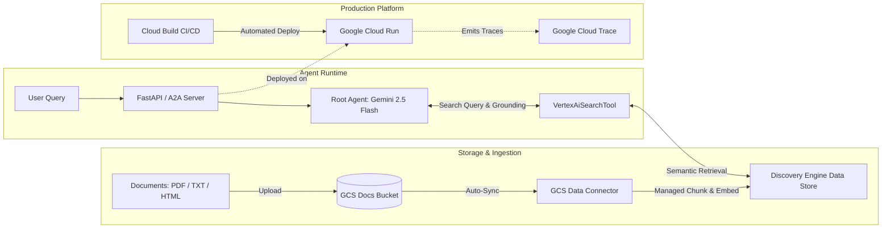
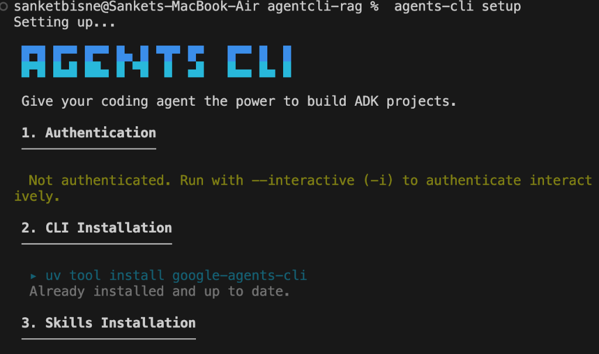
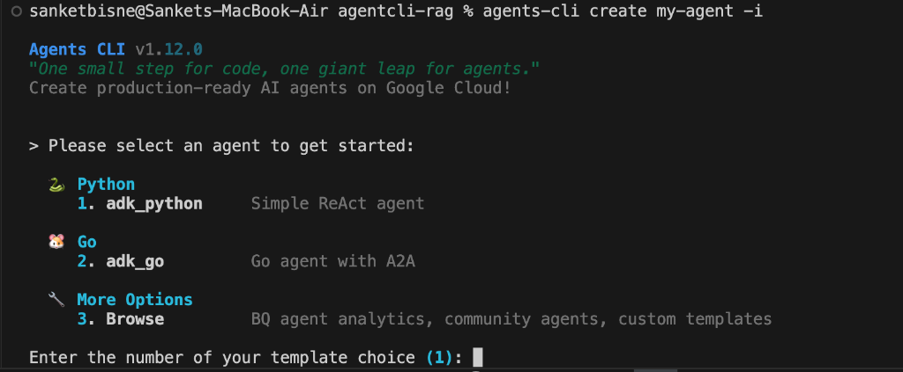
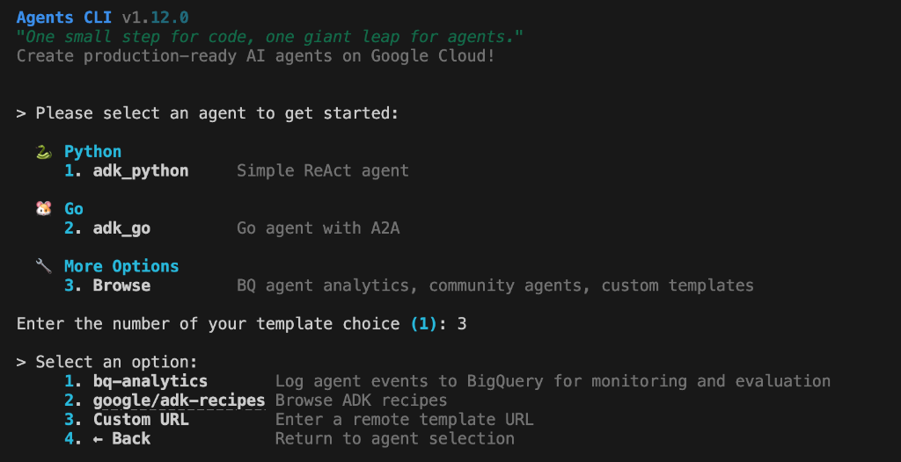
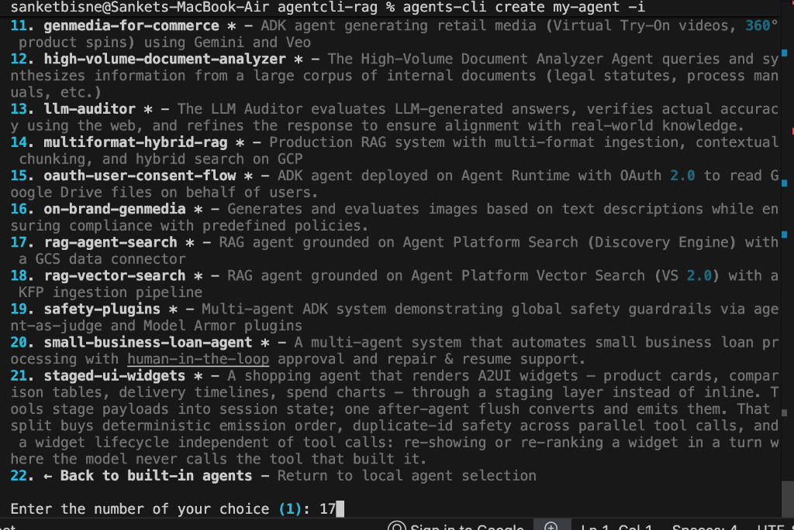
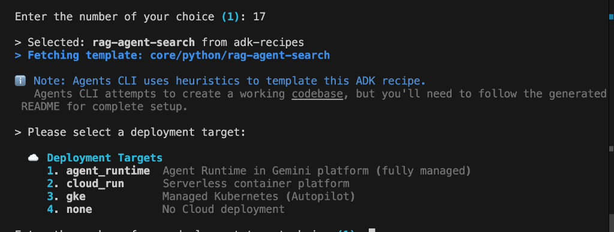

# Enterprise RAG Agent with Google Agents CLI & ADK

A production-grade Retrieval-Augmented Generation (RAG) agent built using the **Google Agent Development Kit (ADK)** and scaffolded via **Google Agents CLI (`agents-cli`)**.

The agent is grounded on unstructured enterprise documents indexed in **Agent Platform Search** (Discovery Engine). Documents land in a Google Cloud Storage bucket and are automatically ingested, chunked, and embedded by a managed **GCS Data Connector** — requiring **zero custom ingestion pipeline code**. It features serverless hosting on **Google Cloud Run**, automated **Cloud Build CI/CD**, and native **OpenTelemetry** tracing.

---

## 🏗️ Architecture



---

## 📸 Interactive Scaffolding Walkthrough

The project was generated using the official Google ADK recipe catalog via `agents-cli create my-agent -i`. Below is the step-by-step interactive terminal flow:

### 1. Agents CLI Environment & Skills Setup
Run `agents-cli setup` to install necessary coding agent skills and verify Google Cloud CLI / environment prerequisites.



```bash
agents-cli setup
```

### 2. Launch Interactive Scaffolding
Start the interactive project wizard. Choose option `3. Browse` to explore Google's production architectures.



```bash
agents-cli create my-agent -i
```

### 3. Browse Google ADK Recipes
Select option `2. google/adk-recipes` to access Google's curated agent recipes.



### 4. Select Enterprise RAG Template (`rag-agent-search`)
Select option `17. rag-agent-search *` — a RAG architecture grounded on Agent Platform Search (Discovery Engine) with a GCS data connector.



### 5. Select Cloud Run Deployment & Cloud Build CI/CD
Configure the production deployment target, session storage, and CI/CD pipeline:
* **Deployment Target:** `2. cloud_run` (Serverless container platform)
* **Session Persistence:** `1. in_memory` (Stateless, fast in-memory sessions)
* **CI/CD Runner:** `2. google_cloud_build` (Automated PR testing & container builds)
* **Region:** `us-east1`



---

## 📁 Repository Structure

```
.
├── README.md                                  # Project overview and documentation
├── screenshots/                               # Scaffolding walkthrough screenshots
│   ├── 01_agents_cli_setup.png
│   ├── 02_create_agent_menu.png
│   ├── 03_browse_adk_recipes.png
│   ├── 04_select_rag_agent_search.png
│   └── 05_select_deployment_target_cloud_run.png
└── my-agent/                                  # Scaffolded ADK RAG Project
    ├── app/
    │   ├── agent.py                           # Root Agent wiring Gemini 2.5 Flash & Search Tool
    │   ├── retrievers.py                      # VertexAiSearchTool abstraction (with test mock)
    │   └── fast_api_app.py                    # REST & SSE streaming server
    ├── infra/terraform/                       # GCS bucket, Data Connector & Search Engine HCL
    ├── .cloudbuild/
    │   ├── pr_checks.yaml                     # Automated PR unit/integration tests
    │   └── deploy-to-prod.yaml                # Docker build & Cloud Run deployment
    ├── tests/
    │   ├── test_runnability.py                # Runnability and syntax assertions
    │   ├── unit/                              # Unit tests
    │   ├── integration/                       # Integration tests (with mocked retrievers)
    │   └── eval/                              # Golden datasets for automated quality grading
    ├── agents-cli-manifest.yaml               # Single source of truth for the project
    └── pyproject.toml                         # Fast Python package management via uv
```

---

## 🚀 Quick Start Guide

### Prerequisites
* Python 3.11+
* [`uv`](https://docs.astral.sh/uv/) installed: `curl -LsSf https://astral.sh/uv/install.sh | sh`
* [Google Cloud SDK (`gcloud`)](https://cloud.google.com/sdk/docs/install)
* [Terraform](https://developer.hashicorp.com/terraform/install)
* Install Google Agents CLI:
  ```bash
  uv tool install google-agents-cli
  ```

---

### 1. Local Setup & Authentication

Navigate to the agent project directory:
```bash
cd my-agent
```

Authenticate with Google Cloud:
```bash
agents-cli login -i
# or
gcloud auth application-default login
```

Copy the example environment configuration:
```bash
cp .env.example .env
```
Ensure `GOOGLE_CLOUD_PROJECT` is set to your active GCP Project ID, and `MODEL_NAME=gemini-2.5-flash`.

---

### 2. Verify Runnability & Tests

Verify that dependencies and the agent initialize successfully:
```bash
uv run pytest tests/test_runnability.py
```

Run integration tests (retrievers are automatically mocked via `INTEGRATION_TEST=TRUE` to avoid incurring live cloud costs):
```bash
make test
```

---

### 3. Local Interactive Prototyping (ADK Playground)

Start the local web UI to chat with your agent, inspect tool calls, and test prompt iterations:
```bash
agents-cli playground --reload_agents
```
Open **`http://localhost:8501`** in your browser. With `--reload_agents`, any changes made to `app/agent.py` are hot-reloaded instantly without restarting the server.

---

### 4. Provision Grounding Infrastructure (Terraform)

Provision the Google Cloud Storage bucket, managed Data Connector, and Discovery Engine data store:
1. Update `infra/terraform/vars/env.tfvars` with your GCP project ID and region.
2. Run the automated provisioning target:
   ```bash
   make setup-infra
   ```
3. Copy the Terraform output values (`data_store_id` and `data_store_collection`) into your `.env` file.

---

### 5. Ingest Documents into Search Engine

Upload unstructured documents to Cloud Storage and trigger an immediate ingestion sync:
```bash
# Upload sample files (or your own custom PDF/TXT/HTML files)
make upload-sample-data

# Trigger immediate Discovery Engine ingestion (bypasses daily refresh interval)
make ingest
```

---

### 6. Automated Quality Evaluation (`agents-cli eval`)

Run automated inference over your golden evaluation dataset and score responses using Gemini as an objective judge:
```bash
agents-cli eval run
```
To ensure that prompt changes never introduce regressions, compare two evaluation runs:
```bash
agents-cli eval compare baseline_eval.json new_eval.json
```

---

### 7. Production Deployment (Cloud Run)

Deploy your containerized agent directly to Google Cloud Run:
```bash
agents-cli deploy --deployment-target cloud_run
```

What `agents-cli deploy` handles automatically:
* Builds the container using Cloud Build and pushes to Google Artifact Registry.
* Configures Cloud Run with concurrency tuning (default 8 concurrent requests per container).
* Enables automatic HTTPS endpoints and IAM authentication.
* Injects OpenTelemetry environment variables for Google Cloud Trace.

---

### 8. Continuous Integration / Continuous Deployment (CI/CD)

The project ships with pre-configured Google Cloud Build pipelines:
* **`.cloudbuild/pr_checks.yaml`**: Runs on every pull request — installs dependencies with `uv`, executes linter checks, and runs unit + integration tests with mocked retrievers.
* **`.cloudbuild/deploy-to-prod.yaml`**: Runs upon merging to `main` — builds the production container, pushes to Artifact Registry, and deploys the updated revision to Cloud Run using `uvx google-agents-cli deploy`.

---

## 📊 Observability & Monitoring

The agent is pre-instrumented with `opentelemetry-resourcedetector-gcp`:
* **Cloud Trace**: View distributed latency traces breaking down network time, agent reasoning, Discovery Engine retrieval duration, and Gemini streaming latency.
* **BigQuery Agent Analytics**: Stream conversation history, token usage, and user feedback into BigQuery for long-term telemetry and evaluation.

---

## 🤝 Publishing to Agent Registry

Make your agent discoverable across your enterprise:
```bash
agents-cli publish gemini
```
Registers your deployed Cloud Run endpoint with Google Cloud's **Agent Registry**, enabling integration with Gemini Enterprise and the open **Agent-to-Agent (A2A)** HTTP protocol.

---

## 📄 License

Apache License 2.0. Built with Google Agent Development Kit (ADK) and Google Agents CLI.
